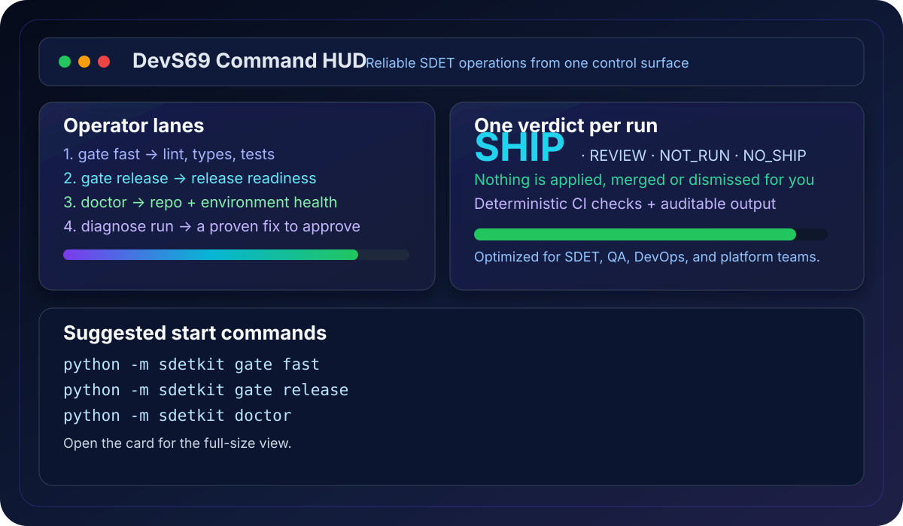
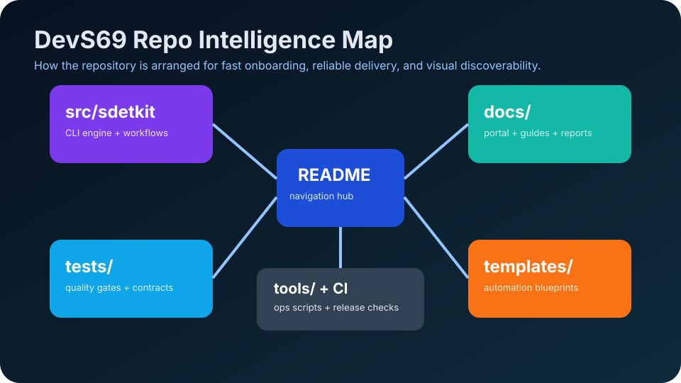
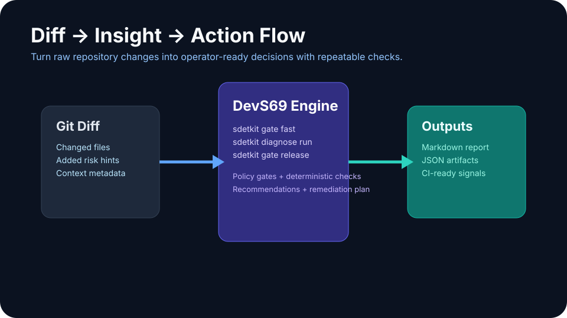

# DevS69 Visual HUD Showcase

Large, clickable visual cards with quick usage hints.

> Portal redirect: https://sherif69-sa.github.io/DevS69-sdetkit/

## Command HUD

**Quick hint:** Start with `python -m sdetkit gate fast` for your first verdict and the next command to run.

[Open full Command HUD view](command-hud-live.md)

## Repo Map

**Quick hint:** Use this visual to understand where source, tests, docs, templates, and tooling are located.

[Open full Repo Map view](repo-map-live.md)

## Diff-to-Decision

**Quick hint:** Follow the sequence: `gate fast` → `diagnose run --prove` on a failure → `gate release`.

[Open full Diff-to-Decision view](diff-flow-live.md)
